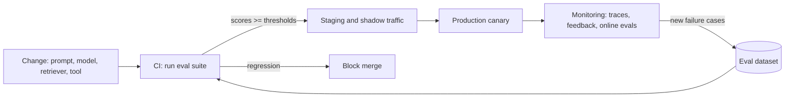

# Domain 6: Evaluation, Observability and LLMOps

**Weight: 12%** · **Time: 8-10 hours** · [Back to course](README.md)

You cannot ship what you cannot measure. Architects design the evaluation and operations system that keeps quality, safety and cost visible from the first prototype to years in production.

## Learning objectives

- [ ] Build an evaluation set and choose metrics for RAG, extraction and agent tasks.
- [ ] Combine code-based checks, LLM-as-judge and human review, knowing the limits of each.
- [ ] Put evaluations in CI so prompt, model and retrieval changes are gated.
- [ ] Design tracing and monitoring for LLM apps and agents (OpenTelemetry-based where possible).
- [ ] Plan online evaluation: feedback, A/B tests, drift and incident response.
- [ ] Describe an LLMOps lifecycle: versioning prompts, models, indexes and datasets.

## Core concepts

### Evaluation types

| Type | How | Good for | Limits |
| --- | --- | --- | --- |
| Code-based checks | Exact match, regex, JSON schema, unit tests on tool calls. | Extraction, classification, format. | Cannot judge open-ended quality. |
| Reference-based | Compare to a gold answer (similarity, key facts present). | Q&A with known answers. | Needs curated references. |
| LLM-as-judge | A model grades with a rubric. | Faithfulness, helpfulness, tone at scale. | Bias and drift; calibrate against human labels. |
| Human review | Experts grade samples. | High-stakes domains, calibrating judges. | Slow, costly. |
| Red teaming | Adversarial prompts and attacks. | Safety, injection, data leakage. | Needs ongoing updates. |

### Metrics by system type

| System | Key metrics |
| --- | --- |
| RAG | Retrieval: recall at k, context precision. Generation: faithfulness (grounded in context), answer relevance, citation accuracy. |
| Extraction | Field-level precision, recall and F1; schema validity rate. |
| Classification and routing | Accuracy, per-class precision and recall, confusion matrix. |
| Agents | Task success rate, steps per task, tool-call correctness, cost and time per task, rate of human escalation. |
| All | Latency (TTFT, total), cost per request, refusal rate, safety violations, user feedback. |

### Building the evaluation set

1. Start with 50-200 realistic cases from real logs or experts, not only synthetic ones.
2. Cover **slices**: common cases, edge cases, adversarial inputs, each user group and language.
3. Store inputs, expected outputs or rubrics, and metadata in version control.
4. Grow it continuously: every production failure becomes a new test case.

### Evaluation in the delivery pipeline

### Observability

Trace every request end to end: input, retrieved documents, prompts sent, model and version, tool calls and results, output, latency per span, tokens and cost, user feedback. OpenTelemetry semantic conventions for generative AI let you send traces to standard backends. Mask or exclude sensitive data in traces according to policy, and set retention limits.

### LLMOps lifecycle

| Asset | Version it | Example practice |
| --- | --- | --- |
| Prompts | Yes, in Git or a prompt registry. | Review prompt changes like code. |
| Models | Pin exact versions. | Upgrade through eval gates. |
| Retrieval index | Version by corpus snapshot, chunking and embedding model. | Blue-green index swaps. |
| Eval datasets | Yes. | Changelog of added cases. |
| Agent tools | Version APIs and MCP servers. | Contract tests for tools. |

## Patterns and anti-patterns

**Patterns**

- Calibrate LLM judges on 50-100 human-labeled examples and report agreement.
- Shadow deployments for model upgrades.
- Dashboards per use case combining quality, cost and adoption.

**Anti-patterns**

- "Vibe checks" on five prompts as the release gate.
- Logging prompts with sensitive data to a third-party tool without review.
- Only offline evaluation; never looking at production traces.

## Reading list

- [promptfoo](https://github.com/promptfoo/promptfoo) - Test, evaluate and red-team prompts and agents from the command line and CI.
- [DeepEval](https://github.com/confident-ai/deepeval) - Pytest-style framework with RAG and agent metrics.
- [Ragas](https://github.com/explodinggradients/ragas) - Evaluation toolkit for RAG pipelines.
- [Langfuse](https://github.com/langfuse/langfuse) - Open-source LLM tracing, prompt management and evaluation.
- [Arize Phoenix](https://github.com/Arize-ai/phoenix) - OpenTelemetry-based tracing and evaluation for LLM apps.
- [OpenLLMetry](https://github.com/traceloop/openllmetry) - OpenTelemetry instrumentation for LLM providers and frameworks.
- [Inspect](https://github.com/UKGovernmentBEIS/inspect_ai) - UK AI Security Institute's framework for LLM evaluations.
- [OpenAI Evals](https://github.com/openai/evals) - Framework and registry of benchmarks for evaluating models.
- [Awesome LLMOps](https://github.com/tensorchord/Awesome-LLMOps) - Curated list of LLMOps tools.
- [OpenTelemetry semantic conventions for generative AI](https://opentelemetry.io/docs/specs/semconv/gen-ai/) - Standard attribute names for LLM traces.

## Free credentials for this domain

From the [tracker](../free-certifications/README.md#agents-mcp-and-orchestration):

- Salesforce Trailhead: *Agentforce Testing Tools and Strategies*.
- Google Skills: *Machine Learning Operations (MLOps) for Generative AI*.
- AWS Skill Builder: *AWS MLOps Demonstrated* microcredential.

## Hands-on lab: evaluation gate

1. Take the RAG assistant from Domain 3 or 4.
2. Create a 60-case evaluation set with three slices: normal, edge, adversarial.
3. Score faithfulness and answer relevance with an LLM judge; label 30 cases yourself and measure agreement.
4. Wire the suite into GitHub Actions so a pull request fails if faithfulness drops more than 3 points.
5. Instrument the app with Langfuse or Phoenix and inspect traces for the five worst cases.
6. **Deliverable:** eval config, CI workflow, and a short report on judge-human agreement.

## Review questions

1. An LLM judge rates 95% of answers as faithful, but users report frequent errors. What is the likely issue and fix?

   

Answer

   The judge is not calibrated. Compare it to human labels, tighten the rubric, use a stronger or different judge model, and add the failing cases to the set.

   

2. Which metric tells you whether a RAG failure came from retrieval rather than generation?

   

Answer

   Retrieval recall (or context recall): whether the needed passage appeared in the retrieved context at all.

   

3. What should happen in CI when a prompt change lowers extraction F1 from 0.94 to 0.88?

   

Answer

   The merge is blocked by the evaluation gate until the regression is fixed or the threshold change is explicitly approved.

   

4. Name three agent-specific metrics.

   

Answer

   Task success rate, tool-call correctness, steps (or cost and time) per task; escalation rate is also common.

   

5. Traces include customer account numbers. What must the architect specify?

   

Answer

   Masking or redaction before export, access controls on the tracing backend, data residency and retention limits consistent with policy.

   

6. How do production failures improve the system over time?

   

Answer

   Each failure is triaged, turned into a test case in the evaluation set, and the fix must pass it in CI, so regressions cannot recur unnoticed.

   

