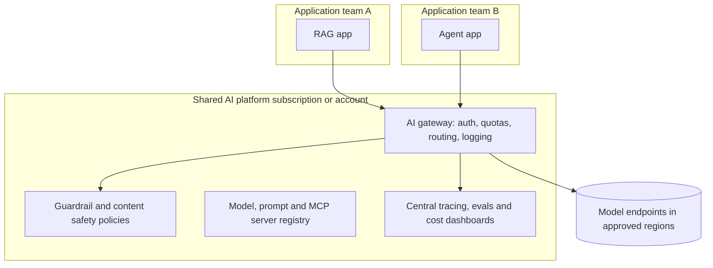

# Domain 8: Cloud Implementation and Well-Architected Review

**Weight: 10%** · **Time: 8-10 hours** · [Back to course](README.md)

Vendor exams test whether you can map a design to concrete services. This domain maps the patterns from earlier domains to AWS, Azure and Google Cloud, and teaches you to run a well-architected review of an AI workload.

## Learning objectives

- [ ] Map an enterprise RAG and agent design to services on AWS, Azure and Google Cloud.
- [ ] Design private networking, identity and key management for AI services.
- [ ] Apply the six well-architected pillars to a generative AI workload.
- [ ] Design a landing zone for AI: shared gateway, guardrails, quotas, logging.
- [ ] Choose regions and deployment types for data residency and capacity.
- [ ] Communicate an architecture with C4 diagrams and architecture decision records.

## Core concepts

### Service mapping

Service names change often; always confirm on the provider's current documentation.

| Capability | AWS | Microsoft Azure | Google Cloud |
| --- | --- | --- | --- |
| Foundation model access | Amazon Bedrock | Azure AI Foundry (Azure OpenAI and model catalog) | Vertex AI (Gemini and Model Garden) |
| Managed RAG | Bedrock Knowledge Bases | Azure AI Search with Foundry | Vertex AI Search, RAG Engine |
| Agents | Bedrock Agents, Bedrock AgentCore | Foundry Agent Service, Copilot Studio | Vertex AI Agent Builder and Agent Engine |
| Guardrails and content safety | Bedrock Guardrails | Azure AI Content Safety | Model Armor, Vertex AI safety settings |
| Vector storage | OpenSearch Serverless, Aurora PostgreSQL pgvector | Azure AI Search, Cosmos DB, PostgreSQL pgvector | AlloyDB and Cloud SQL pgvector, Vertex AI Vector Search |
| Custom ML and fine-tuning | SageMaker AI | Azure Machine Learning, Foundry fine-tuning | Vertex AI training and tuning |
| API gateway | API Gateway | API Management (AI gateway policies) | Apigee |
| Secrets and keys | Secrets Manager, KMS | Key Vault | Secret Manager, Cloud KMS |
| Private connectivity | VPC endpoints (PrivateLink) | Private Endpoints | Private Service Connect |
| Observability | CloudWatch, X-Ray | Azure Monitor, Application Insights | Cloud Logging, Cloud Trace |

### Well-architected pillars applied to generative AI

| Pillar | Key questions for an AI workload |
| --- | --- |
| Operational excellence | Are prompts, models and indexes versioned? Is there an eval gate and runbook? |
| Security | Is retrieval permission-aware? Are tools least-privilege? Is traffic private? Are guardrails on? |
| Reliability | Are quotas sized? Are there retries, fallback models and multi-region options? |
| Performance efficiency | Is the smallest adequate model used? Is streaming on? Is latency measured per span? |
| Cost optimization | Are caching, batching and routing used? Is cost attributed per app? Are budgets set? |
| Sustainability | Are model size and GPU usage right-sized? Is idle capacity avoided? |

AWS, Azure and Google Cloud each publish AI-specific guidance (lenses or well-architected perspectives); read the one for your target exam.

### AI landing zone

Platform teams provide the gateway, guardrails, approved models, network patterns and observability; application teams build use cases on top. This is how organizations scale from one pilot to dozens of AI apps safely.

### Communicating architecture

- **C4 model:** Context, Container, Component, Code. For AI systems, context and container diagrams are usually enough for reviews.
- **ADRs:** short records of decisions with context, options, decision and consequences.
- **Diagrams as code** keep diagrams versioned and reviewable.

## Patterns and anti-patterns

**Patterns**

- Private endpoints for model and data services; no public egress from agent runtimes except allowlisted destinations.
- Separate environments (dev, test, prod) with separate quotas and keys.
- Infrastructure as code for the whole AI stack, including guardrail configurations.

**Anti-patterns**

- Each team creating its own model keys and endpoints with no central visibility.
- Deploying to a region where the required model or quota is not available, discovered at launch.
- Architecture diagrams that omit identity and data flows.

## Reading list

- [AWS Generative AI Lens](https://docs.aws.amazon.com/wellarchitected/latest/generative-ai-lens/generative-ai-lens.html) - Well-Architected guidance for generative AI workloads.
- [Azure AI workloads in the Well-Architected Framework](https://learn.microsoft.com/en-us/azure/well-architected/ai/) - Design principles and checklists for AI on Azure.
- [Google Cloud Well-Architected Framework: AI and ML perspective](https://cloud.google.com/architecture/framework/perspectives/ai-ml) - AI and ML guidance across the pillars.
- [AWS generative AI samples](https://github.com/aws-samples/generative-ai-use-cases) - Deployable reference application of generative AI use cases on AWS.
- [Azure OpenAI landing zone reference](https://github.com/Azure/azure-openai-landing-zone) - Landing zone patterns for Azure OpenAI.
- [AI Hub Gateway solution accelerator](https://github.com/Azure-Samples/ai-hub-gateway-solution-accelerator) - Central AI gateway with API Management on Azure.
- [Google Cloud generative AI](https://github.com/GoogleCloudPlatform/generative-ai) - Sample code and notebooks for Vertex AI.
- [Diagrams](https://github.com/mingrammer/diagrams) - Draw cloud architecture diagrams as Python code.
- [C4 model](https://c4model.com/) - Simple, hierarchical way to diagram software architecture.
- [Architecture Decision Records](https://github.com/architecture-decision-record/architecture-decision-record) - ADR templates and examples.

## Free credentials for this domain

From the [tracker](../free-certifications/README.md):

- Anthropic Academy: *Claude with Amazon Bedrock* and *Claude with Google Cloud's Vertex AI*.
- Google Skills: *Innovating with Google Cloud Artificial Intelligence* (free course).
- Microsoft Learn: *Introduction to generative AI and agents*.

For paid, proctored exams that validate this domain, see [certifications.md](../certifications.md).

## Hands-on lab: well-architected review

1. Choose one cloud and deploy a small RAG app with its managed model service, a vector store and a private endpoint (use free tiers or credits, and tear down afterward).
2. Put an API gateway in front and enable content safety or guardrails.
3. Run the provider's AI well-architected checklist and record findings for each pillar.
4. Draw C4 context and container diagrams with diagrams as code.
5. Write three ADRs: model platform choice, vector store choice, region choice.
6. **Deliverable:** diagrams, ADRs, review findings with prioritized fixes.

## Review questions

1. A company wants every internal AI app to share quotas, logging and content safety. What should the architect design?

   

Answer

   An AI landing zone with a central AI gateway (for example API Management, API Gateway or Apigee with AI policies), shared guardrails, approved model endpoints and central observability.

   

2. Traffic from a VPC to a cloud model service must not traverse the public internet. What feature is required?

   

Answer

   Private connectivity: VPC interface endpoints with PrivateLink on AWS, Private Endpoints on Azure, or Private Service Connect on Google Cloud.

   

3. Under which well-architected pillar does "pin model versions and gate upgrades with evaluations" fall?

   

Answer

   Operational excellence (with reliability benefits).

   

4. A European customer requires data processing to stay in the EU. What must you verify before choosing a model?

   

Answer

   That the model is offered in an EU region (or EU data zone) with the needed quota, and that the deployment type keeps processing and storage in the EU under the provider's terms.

   

5. What is the purpose of an ADR in an AI project?

   

Answer

   To record important decisions (model platform, vector store, build vs buy) with context, options and consequences so future teams understand why, and can revisit when facts change.

   

6. Which two C4 levels are usually enough for an AI design review?

   

Answer

   System context and container diagrams.

   

